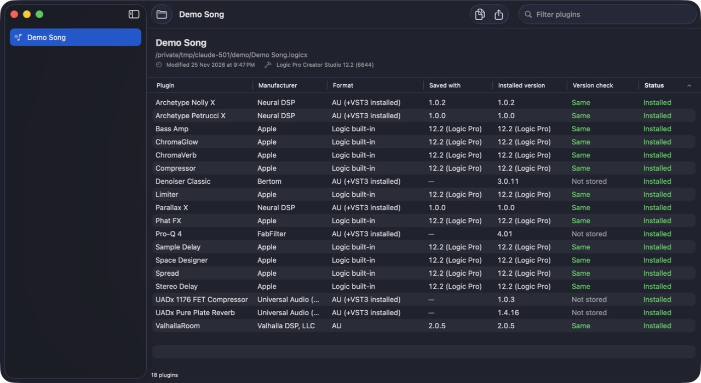

# Plugin Lens

**See every plugin a DAW project uses, which version it was saved with, and what you have installed now.** Logic Pro, Ableton Live, REAPER, Waveform and Ardour.

Plugin Lens is a small native macOS app (Swift + SwiftUI, no dependencies). Point it at a project, or a folder full of them, and it lists
each plugin with its manufacturer, format, the version the project was saved with (when the plugin records one), the version installed on
this Mac, and whether they match. It is read-only: it never modifies a project and makes no network requests.



## Why

Before you open a project on another machine, hand it to a collaborator, or update your plugins, you want to know what it needs.
Your DAW only tells you after it fails to load something. Plugin Lens answers up front: what's missing, and what has changed since the project was saved.

## Features

- Open a project, or a folder (scanned recursively for `.logicx` packages, extracted project folders and `.als` sets; Live's `Backup` folders are skipped).
- Sidebar of projects; one bad project never blocks the others, its error is shown in its own pane.
- Table: **Plugin, Manufacturer, Format, Saved with, Installed version, Version check, Status**. Sortable and searchable.
- Missing plugins and version changes are flagged (red/orange).
- **Copy as Markdown** and **Export CSV** per project.
- Scanning and parsing run in the background with a progress bar.
- Works for any plugin from any manufacturer: plugins are matched to installed bundles by their Audio Unit codes (type, subtype, manufacturer), not by name.
- Finds the saved version by itself, using several independent methods (below), and says how sure it is.

## Supported DAWs

| DAW | Files | Status |
|---|---|---|
| Logic Pro | `.logicx` | **Validated** on about 60 real projects saved by Logic Pro Creator Studio 12.2. |
| Ableton Live 10-12 | `.als` | Validated on the 26 sets bundled with Live 12.4.6 (built-in devices, gzip/XML). Third-party plugin entries not yet validated on a real set. |
| REAPER | `.rpp` | Built from the documented text format and tested on synthetic projects; **not yet validated on a real project**. |
| Waveform (Tracktion) | `.tracktionedit` | As REAPER: format-based, synthetic tests only. |
| Ardour | `.ardour` | As REAPER: format-based, synthetic tests only. LV2 plugins are listed but not checked. |
| GarageBand, MainStage | `.band`, `.concert` | **Experimental.** Read with the Logic parser on the assumption that they share its project format; no real file has been tested. |

"Validated" means checked against real files from that DAW. The others are implemented from the published or well-known file formats, are covered by
unit tests built from that knowledge, and show a clear error rather than a wrong answer when a file doesn't match. If a project from one of them is read wrongly,
please open an issue (the first lines of the file and the DAW version are enough). Not supported: Pro Tools, Cubase/Nuendo, FL Studio, Studio One, Bitwig, Reason.

## Install

1. Download `PluginLens-0.2.0-macOS.zip` from the [Releases](../../releases) page and unzip it. It is a universal build (Apple Silicon and Intel), macOS 14 or later.
2. The app is ad-hoc signed and **not notarized**, so macOS will block the first launch. Right-click the app, choose **Open**, then **Open** again; or run:

   ```bash
   xattr -dr com.apple.quarantine PluginLens.app
   ```

Or build it yourself (below).

## Build

Requires macOS 14+ and Xcode 15 or later. No other setup.

```bash
open PluginLens.xcodeproj        # then Run (⌘R)
```

```bash
xcodebuild -project PluginLens.xcodeproj -scheme PluginLens -configuration Release -destination 'generic/platform=macOS' build
xcodebuild -project PluginLens.xcodeproj -scheme PluginLens -destination 'platform=macOS' test
```

`PluginLens.xcodeproj` is generated from `project.yml` by [XcodeGen](https://github.com/yonaskolb/XcodeGen) and committed, so XcodeGen is only needed
if you change targets or settings. The app is not sandboxed because it must read arbitrary project folders and the system plugin folders.
For scripting, `--open <path>` loads a project or folder at launch.

## What the columns mean

| Column | Meaning |
|---|---|
| Plugin / Manufacturer | From the installed bundle when found; otherwise Logic's (truncated) name and the 4-character manufacturer code. |
| Format | `AU`, or `Logic built-in`. `(+VST3 installed)` means a same-named VST/VST3 is also installed (Logic can't load it, so it's informational). |
| Saved with | The plugin version recorded in the project, if the plugin records one. Built-ins show the Logic version that saved the project. |
| Installed version | `CFBundleShortVersionString`, falling back to `CFBundleVersion`, of the matching bundle. |
| Version check | Same / Installed is newer / Installed is older / Can't compare / Not stored. |
| Status | Installed / Not installed / Version unknown. A match that isn't certain is labelled *uncertain* and never reported as a confident version. |

## How it works

Logic's `ProjectData` file is undocumented. Plugin Lens was built by inspecting real projects and does not decode the whole file; it finds
plugin records and validates each one. Details and evidence are in [docs/FORMAT.md](docs/FORMAT.md). In short:

- Each plugin instance is a record holding a truncated 11-character name and the AU manufacturer, type and subtype codes (byte-reversed).
  Logic's own built-in plugins use the same record with a marker instead of AU codes.
- **Installed lookup** reads `AudioComponents` from bundles in `~/Library/Audio/Plug-ins/Components`, `/Library/Audio/Plug-ins/Components`,
  `/System/Library/Components`, and Audio Unit v3 app extensions in `/Applications` and `~/Applications`. VST/VST3 folders are checked for the informational note.
- **Saved version.** No DAW writes one universal "plugin version" field, so Plugin Lens looks in several places, most trustworthy first,
  and reports where it found each value and how reliable it is:

  | # | Source | Shown as | Check |
  |---|---|---|---|
  | 1 | The AU state's own `version` field. AU plugins built on Apple's base classes store their component version there (Neural Amp Modeler, Gateway) | `0.7.13` | compared exactly with the installed component |
  | 2 | A version the plugin writes into its saved state under a known convention: `pluginVersion="x.y.z"` (Valhalla, Neural DSP, soothe2), `"productVersion"` (Serum 2), `PlugVersion` (Toontrack), `Pianoteq x.y.z/…`, plus any of these inside zlib-compressed state | `2.0.5` | Same / Installed is newer / Installed is older |
  | 3 | A generic search of the state for `…version…: x.y.z` fields (excluding format, schema, preset and dependency versions) and the highest Antares `ChunkVersion` | `1.0.0 (unverified)` | **Unverified**: shown, never judged |
  | 4 | The product generation in the plugin's name: "Ozone 12", "RX 11", "Pro-Q 4", "AmpliTube 5" | `12 (from name)` | **Same major** / Different |

  If none of these exist the project does not contain the plugin's version (this was checked by decompressing and inspecting the state of
  FabFilter, Universal Audio UADx, iZotope, Native Instruments, Soundtoys and others), the column shows "—" and the check says **Not stored**.
  Nothing can recover a value that was never written.

## Supported versions

**Logic Pro**: developed and validated against projects saved by **Logic Pro Creator Studio 12.2** (about 60 real projects). Other versions are untested: projects saved by a newer major
version open with a warning, and older `.logic` (pre-`.logicx`) projects are listed as unsupported. If a project doesn't read correctly, please open an issue with the
Logic version and, if you can share it, the output of `xxd` on the first 128 bytes of `Alternatives/000/ProjectData`.

## Known limitations

- Logic hosts only Audio Units, so VST and VST3 never appear as a project's format.
- Names inside a project are truncated to 11 characters; plugins that aren't installed are shown by that name and the manufacturer code.
- Logic built-ins have no AU codes: only a few have friendly display names, the rest show Logic's internal short name, and their version is Logic's.
- Plugins are found by scanning for records, not by fully parsing the project, so the app doesn't know which track or slot a plugin is on, or whether it is bypassed. Duplicates are merged.
- When a project has several alternatives, the most recently modified one is read.
- Never-saved "Untitled" projects contain only undo data and are reported as having no project file.

## Tests

88 unit tests: Logic parser (real-record fixtures plus synthetic, truncated, garbage and corrupt input), Ableton sets (gzip, XML, racks, VST3 class IDs, the Live database), REAPER/Waveform/Ardour projects, saved-version discovery, version lookup against fake plugin
bundles in a temp folder (so results don't depend on your machine), discovery, per-project failure isolation, and exports.
Fixtures in `Tests/Fixtures` are built by `Tools/make_fixtures.py`: only about 40 bytes per plugin record are kept; track names, text, plugin state and everything else
are dropped (ProjectData never contains audio). `mixed_missing` has one manufacturer code rewritten so it is guaranteed not to be installed.

An opt-in check runs against your own library: set `PLUGINLENS_PROJECTS` to a folder and run the `RealProjectsCheckTests` test.
It prints a summary and fails if any project fails unexpectedly.

## Contributing

Issues and pull requests are welcome. Another DAW is a good first contribution: write a parser that returns a `HostDocument` of `FoundPlugin`s (see `HostFormats.swift`; REAPER's is about 80 lines), and `HostResolver` does the matching, versions and checks. Or add a saved-version convention for a plugin you use:
add a pattern to `SavedVersionExtractor`, a test, and a line in the table above. Please only describe plugin state you have inspected yourself.

## Disclaimer

Plugin Lens is an independent project, not affiliated with or endorsed by Apple or Ableton. "Logic Pro" and "Audio Units" are trademarks of Apple Inc.; "Ableton Live" is a trademark of Ableton AG.
The Logic project format is reverse-engineered and may change in any Logic update.

## License

[MIT](LICENSE)
